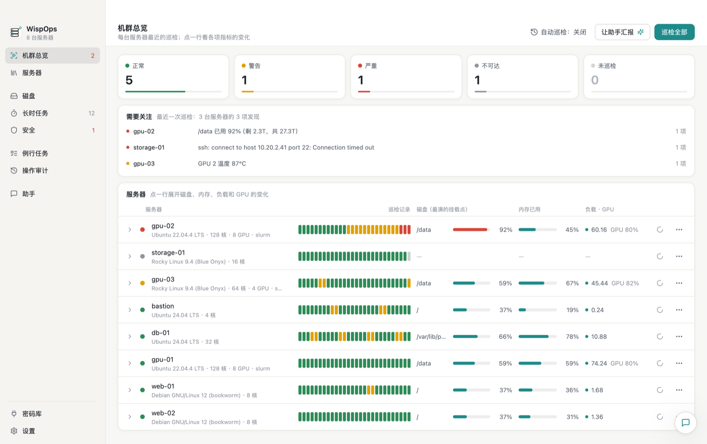
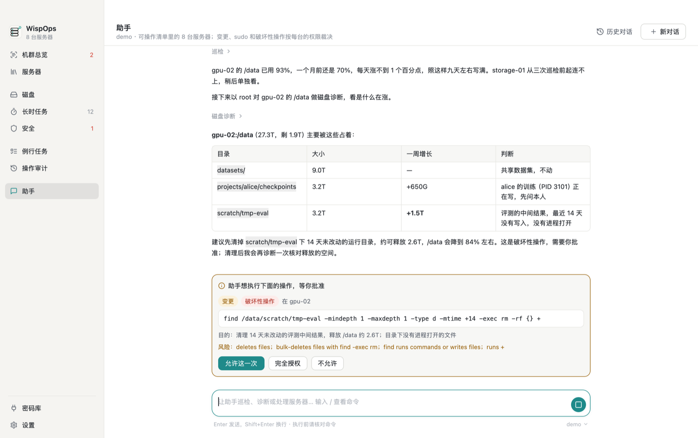
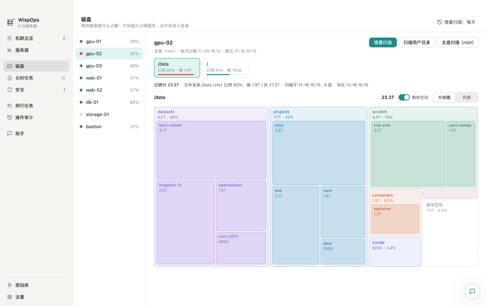
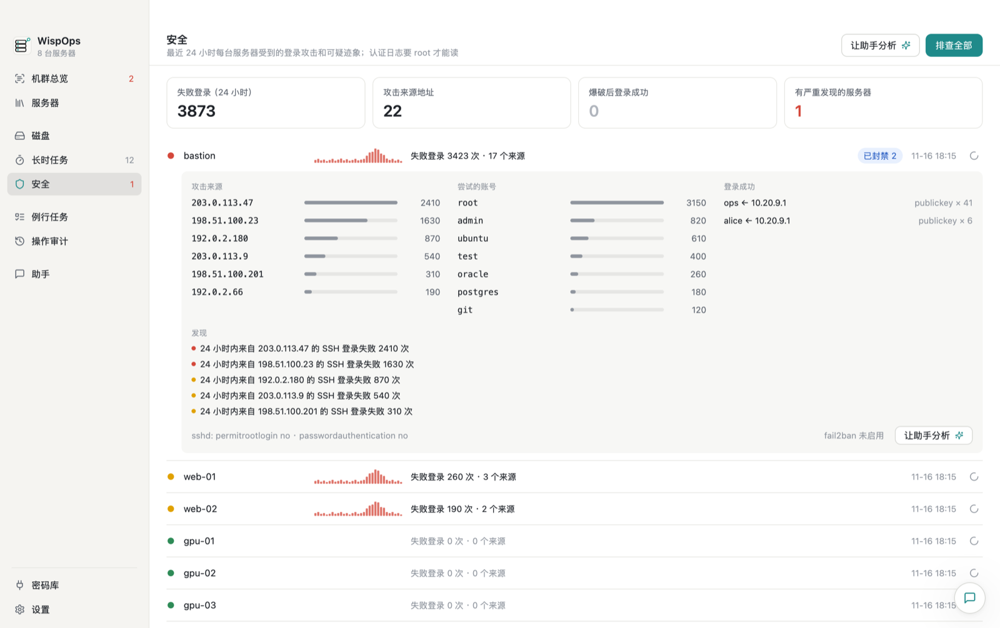
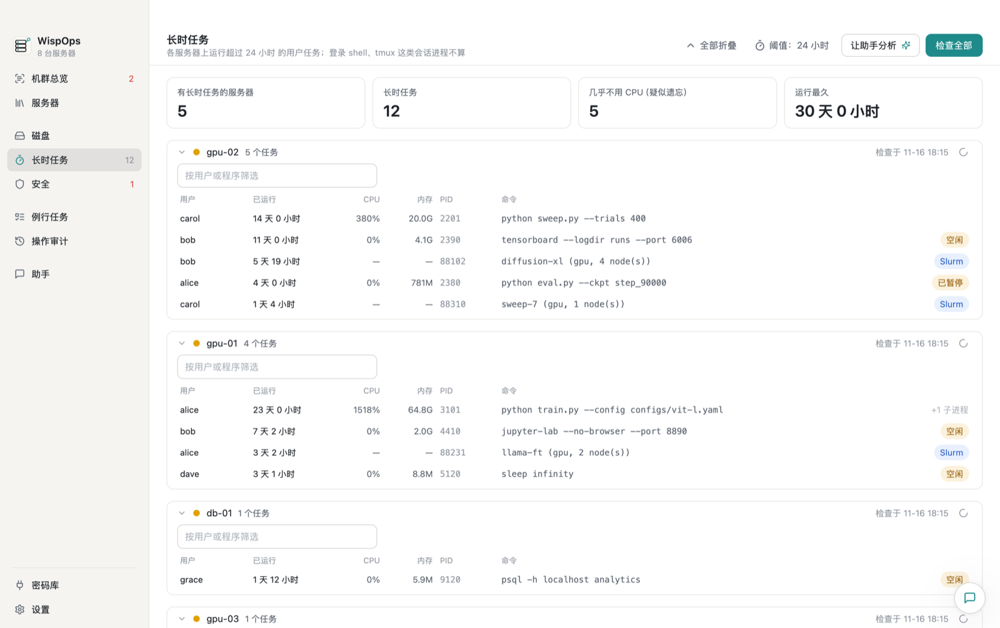
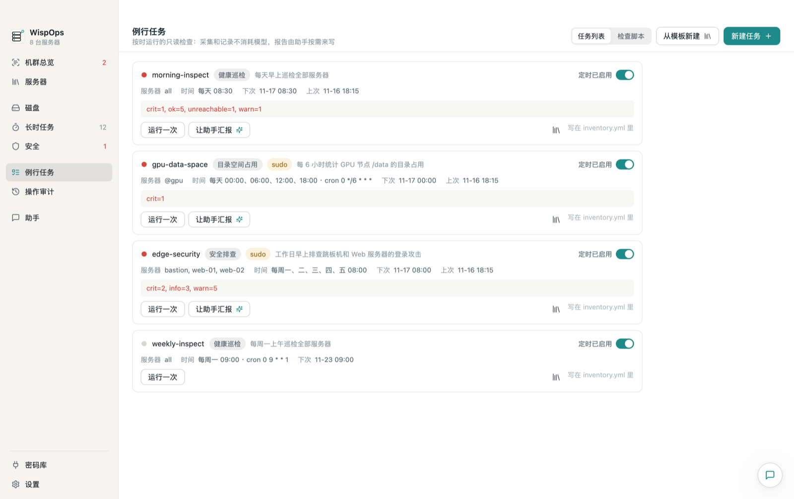
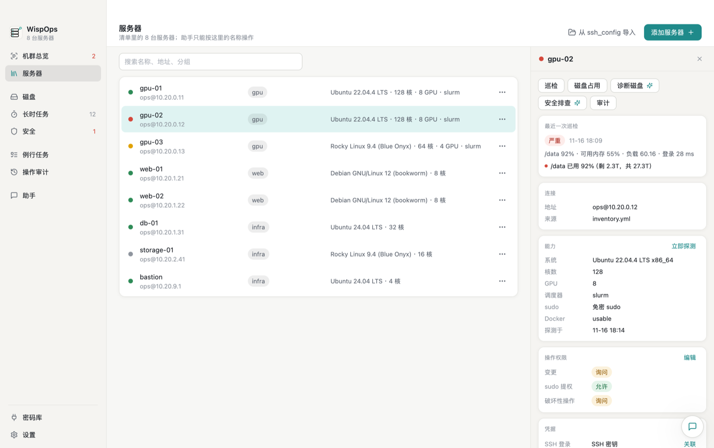

<p align="center">
  
</p>

<h1 align="center">WispOps</h1>

<p align="center">
  AI 原生的服务器运维桌面工具：一份 SSH 主机清单，只读的巡检与诊断，<br>
  一位和你用同一套受控工具工作的助手。
</p>

<p align="center">
  <a href="https://github.com/xuzhougeng/WispOps/releases/latest"></a>
  <a href="https://github.com/xuzhougeng/WispOps/actions/workflows/ci.yml"></a>
  
  <a href="LICENSE"></a>
</p>

<p align="center">
  <a href="https://github.com/xuzhougeng/WispOps/releases/latest"><b>下载</b></a> ·
  <a href="#看一看">看一看</a> ·
  <a href="#权限模型">权限模型</a> ·
  <a href="#从源码运行">从源码运行</a>
</p>

<picture>
  <source media="(prefers-color-scheme: dark)" srcset="docs/screenshots/overview-dark.png">
  
</picture>

用 Rust + GPUI 写成的原生程序。巡检、磁盘、安全排查这些只读的事直接做，结果按服务器存下来、画成能一眼看懂的页面；助手通过同一套工具工作，变更、sudo、破坏性操作在执行前逐主机裁决，密码只交给 SSH，不回显给界面，也不给模型。

整体逻辑移植自 DeepSeek Harness 插件 [dsh-wisp-ops](https://github.com/wisp-science/WispOps)；助手的协议层和界面基础件取自 Wisp Paper。

> **早期版本。** 各页面的只读功能在 macOS 上对几台用密钥登录的真实 Linux 服务器跑通过；助手对话、密码登录与 sudo 凭据、变更操作，以及 Windows 和 Linux 桌面端，还没有在真实环境里系统验证。第一次使用请先接一台不重要的机器，保持变更 / sudo / 破坏性操作为默认的「询问」，执行前核对审批卡片里的命令。

## 看一看

> 截图里的服务器、地址和数据都是虚构的：`scripts/screenshots/` 用一个假的 `ssh` 和一个演示用的模型端点驱动真实的程序生成，见[重新生成截图](#重新生成截图)。

### 助手：先诊断，再请你批准

问它「哪台服务器的磁盘快满了」，它先巡检全部服务器，再以 root 对最紧张的那台做磁盘诊断，把占用和增长整理成表，最后提出清理方案。删除是破坏性操作，所以停在一张审批卡片上：哪台主机、什么能力、确切的命令、它给的理由、分类器看出的风险，由你决定「允许这一次」「完全授权」还是「不允许」。



助手平时收在每个页面右下角的圆形按钮里，打开后悬浮在页面上，也可以停靠为右侧一栏；保存的对话在助手页的「历史对话」里，可以搜索、接着说。

### 磁盘：是什么占着，什么在涨

每块磁盘的方块图：方块是目录，面积按占用，大方块里显示下一级，点击进入。第一次扫描选「用户目录」（不需要 root）或「全盘」（以 root 统计每个本地文件系统），之后按间隔增量扫描，标出比上次多出来的部分和增长最多的目录。



### 安全、长时任务、例行任务、服务器

<table>
  <tr>
    <td width="50%" valign="top">
      
      <p><b>安全</b>：最近 24 小时的登录攻击，来源地址、尝试的账号、逐小时分布，爆破后的成功登录和其他可疑迹象。</p>
    </td>
    <td width="50%" valign="top">
      
      <p><b>长时任务</b>：运行超过阈值的用户进程和 Slurm 作业，谁的、跑了多久、占多少 CPU 和内存，几乎不用 CPU 的标为疑似遗忘。</p>
    </td>
  </tr>
  <tr>
    <td width="50%" valign="top">
      
      <p><b>例行任务</b>：把只读检查绑到服务器上，按每天、固定间隔或 cron 定时运行并记录；正常运行不消耗模型。</p>
    </td>
    <td width="50%" valign="top">
      
      <p><b>服务器</b>：清单、能力探测、三项操作权限（允许 / 询问 / 拒绝），SSH 与 sudo 凭据的关联和测试。</p>
    </td>
  </tr>
</table>

## 安装

从[发布页](https://github.com/xuzhougeng/WispOps/releases/latest)下载：

| 平台 | 文件 | 说明 |
|---|---|---|
| **macOS**，Apple 芯片 | `WispOps-v<版本>-macos-arm64.dmg` | 打开后把 WispOps 拖进「应用程序」 |
| **macOS**，Intel | `WispOps-v<版本>-macos-x64.dmg` | 同上 |
| **Windows** 10 / 11（x64） | `WispOps-v<版本>-windows-x64.zip` | 解压后运行 `WispOps.exe` |
| **Linux**（x64） | `WispOps-v<版本>-linux-x64.tar.gz` | 解压后运行 `wisp-ops`；没有在真机上测试过 |

安装包没有代码签名：macOS 第一次打开如果提示无法验证开发者或文件已损坏，执行 `xattr -cr /Applications/WispOps.app`；Windows 出现「Windows 已保护你的电脑」时点「更多信息」→「仍要运行」。发布里的 `SHA256SUMS` 是各文件的校验和。

需要本机有 OpenSSH 客户端（`ssh`），目标主机按 GNU/Linux 处理。

### 检查更新

「设置 › 通用 › 更新」：默认在启动时向 GitHub 查询本仓库最新的正式发布（`releases/latest`，忽略草稿和预发布版本），之后每天最多一次；也可以关掉，或点「立即检查」。请求走设置里的全局代理，只带 `WispOps/<版本>` 这个 User-Agent，没有任何个人信息或遥测。结果和检查时间记在数据文件夹的 `updates.json`；检查失败只记下来、在设置里显示，不反复弹提示。

有新版本时，侧栏「设置」上方出现一条可以关掉的提示，设置里显示版本、发布说明的链接和「下载并校验」：把本平台的安装包（上表中的文件）下载到「下载」文件夹，按发布里的 `SHA256SUMS` 校验，校验通过就在访达 / 资源管理器 / 文件管理器里显示出来；校验不通过的文件会被删除并报告，发布里没有 `SHA256SUMS` 就不下载。因为安装包没有签名，WispOps 不会替换正在运行的程序，也不会打开或运行下载的文件：退出后由你自己安装。没有现成安装包的平台（如 Linux / Windows 的 ARM）只给发布页面的链接。

## 能做什么

| 页面 | 内容 |
|---|---|
| 机群总览 | 每台服务器最近 30 次巡检的状态矩阵，点方块看当次发现；可开自动巡检（只读、不用 sudo、不调用模型） |
| 服务器 | 清单：添加、从 `~/.ssh/config` 导入、能力探测、三项操作权限（allow / ask / deny）、SSH 与 sudo 凭据关联和测试 |
| 磁盘 | 每块磁盘被什么占着的方块图：方块是目录，面积按占用，大方块里显示下一级，点击进入；也可切成列表。第一次扫描选「用户目录」（不需要 root）或「全盘」（以 root 统计每个本地文件系统），之后按间隔自动增量扫描，标出增长的目录 |
| 长时任务 | 各服务器上运行超过阈值（默认 24 小时）的用户进程和 Slurm 作业：谁的、跑了多久、CPU 和内存、是否空闲或已暂停；登录 shell、tmux 这类会话进程不算 |
| 安全 | 最近 24 小时的登录攻击：失败次数、来源地址、尝试的账号、逐小时分布，以及成功登录和其他可疑迹象；认证日志要 root 才能读，能用 root 的服务器自动用 |
| 例行任务 | 把只读检查（巡检、磁盘、目录空间、新增文件、安全排查、自定义只读命令）绑到服务器上，手动或定时运行并记录（每天、固定间隔，或按任务时区计算的五字段 cron 表达式）；报告由助手按需读已采集的结果来写。可以从任务模板库开始（13 个内置模板，或自己存的；模板不含服务器和 sudo，参数填进命令时是一个加引号的词），也可以把已有任务存为模板；助手用 `ops_template_draft` 提议的模板草稿要你审核保存，它不能自己建任务或排时间 |
| 检查脚本 | 例行任务页的第二个标签：助手用 `ops_script_draft` 起草只读的 shell 检查脚本，你读过全文并接受后进入脚本库，才能被例行任务运行（按退出码判断正常 / 警告 / 严重，第一行输出是摘要）。起草、接受、每次运行都按与助手相同的分类器和拒绝清单校验，脚本里不能有 sudo |
| 操作审计 | 助手、窗口、任务执行的每一条远程命令：风险、授权方式、结果 |
| 外部通知 | 设置 › 通用：把自动巡检发现的状态变化（变差、不可达、恢复；第一次只作基准）和例行任务的结果（每次 / 发现问题时 / 问题有变化时）发到企业微信、钉钉、飞书或通用 webhook，可加签或带 Bearer 令牌，有「发送测试通知」。在后台发送、10 秒超时，失败不影响巡检和任务，只在设置页安静地标出；手写在任务里的 `notify`、`notifyOnlyProblems`、`notifyOnChange`、`quietHours` 照插件的规则生效 |
| 后台运行 | 设置 › 通用：「关闭窗口后继续运行」打开时关窗不退出，自动巡检、例行任务、定时磁盘扫描和外部通知照常进行。macOS 默认打开：关窗即隐藏，点 Dock 图标回来，⌘Q 退出；Windows 和 Linux 默认关闭，打开后关闭按钮改为最小化（没有托盘图标），退出用开关旁的按钮 |
| 密码库 | XChaCha20-Poly1305 加密，密钥在 macOS 钥匙串 / Windows DPAPI / `0600` 文件 |
| 设备同步 | 设置 → 通用 → WebDAV 设备同步：把一份加密快照传到 WebDAV 文件夹（默认坚果云），在另一台设备上预览后导入。快照含界面里添加的服务器、凭据关联、权限设置、任务、任务模板（`task-templates.json`，原样携带）和整个密码库，可选服务器 `identityFile` 指定的 SSH 私钥（导入后写到 `ssh-keys/`）；上传前用同步口令以 scrypt + XChaCha20-Poly1305 加密，格式与插件相同，每次上传是新文件。不同步密码库密钥、`inventory.yml`、`config.json`、`settings.json`、审计和历史、限时授权、定时任务的开关。导入替换本机数据、不合并，先把原数据加密备份到 `sync-backups/`；预览后本机或云端有变化、或有定时任务开着时拒绝导入。手动触发，不定时同步。应用密码和同步口令用密码库的密钥加密保存在 `sync.json` |
| 助手 | 右下角的圆形按钮打开，悬浮在页面上，可停靠为右侧一栏，也可作为整页；保存的对话在助手页的「历史对话」里。工具：`ops_hosts` `ops_inspect` `ops_exec` `ops_disk` `ops_files` `ops_security` `ops_change` `ops_task` `ops_template_draft` `ops_script_draft` `ops_history`，外加读技能的 `use_skill` |

助手输入框里的 `/inspect`、`/disk`、`/security`、`/files`、`/history`、`/new` 是内置命令。

## 权限模型

每个动作先分级（read / change / destructive，外加 sudo），再逐主机、逐能力裁决，顺序是 **主机策略 > 所属分组中最严的 > 默认**：

- `allow`：直接执行。
- `ask`：助手里出现一张卡片（主机、能力、确切的命令、模型给的理由），可以「允许这一次」「限时允许同类操作」（一次对话内的限时授权，不含破坏性操作）或「不允许」。
- `deny`：绝对拒绝，批准和授权都不能覆盖；不会来问你。

拒绝清单（默认含 `rm -rf /`、fork 炸弹、`chmod 777 /`）在任何情况下都拦截。认证失败后该主机暂停登录 15 分钟，避免被当成暴力破解。模型只能按清单里的名称指定主机。

## 从源码运行

需要 Rust（版本见 `rust-toolchain.toml`，rustup 会自动安装）；Windows 上还需要 MSVC 构建工具，Linux 上的系统库见 `scripts/linux-build-deps.sh`。

```sh
cargo run --release                              # 运行
cargo run --release --features runtime_shaders   # Xcode 没装 Metal Toolchain 时用这个
cargo test                                       # 五个 crate 的全部测试
cargo clippy --all-targets                       # 应当没有警告
```

`WISP_OPS_HOME=<目录>` 把数据和 `settings.json` 都放到一个目录里，调试时用它，不碰真实数据。

### 重新生成截图

```sh
scripts/screenshots/take.sh          # 写到 docs/screenshots/
```

只在 macOS 上、用调试构建：在临时的数据文件夹里放一份虚构的清单（`inventory.yml`），让 `fake-ssh.py` 冒充八台服务器回答采集脚本、`fake-model.py` 在 127.0.0.1 上扮演助手的一段对话，先跑三十次巡检、磁盘扫描、安全排查和例行任务，再把记录的时间往前摊开，最后逐页截图。不读本机的 `~/.ssh`，也不连接任何真实的服务器或模型。界面改了之后重跑一次即可。

## 数据

默认在 `~/.wisp-ops/`：

- `inventory.yml`：手写的清单（hosts / groups / tasks），可选；格式与插件相同
- `managed.json`：在界面里添加的服务器、凭据关联、权限覆盖、任务
- `task-templates.json`、`template-drafts.json`：自己存的任务模板，助手提议、等待审核的模板草稿
- `config.json`：可选，覆盖默认配置（`defaultPolicy`、`denyPatterns`、`ssh.*`、`limits.*`、`thresholds.*` 等）
- `vault.json`、`audit/`、`inspections/`、`tasks/`、`notifications/`（每次任务通知的结果）、`notify-state.json`（各服务器上次通知的状态）、`conversations/` 等
- `sync.json`（WebDAV 设备同步的设置，密码已加密）、`sync-backups/`、`ssh-keys/`：用了设备同步才有

模型服务和外观在 `settings.json`（macOS：`~/Library/Application Support/WispOps/`），API Key 明文保存、权限 `0600`。

## 结构

| crate | 内容 |
|---|---|
| `crates/engine` | 运维引擎：配置、清单与选择器、风险分级、权限门与限时授权、SSH 运行器、密码库、审计与历史、安全变更、调度。无 GUI、无模型 |
| `crates/collect` | 只读采集器：每个都是「生成脚本 + 解析输出 + 渲染成给模型的文本」的纯函数 |
| `crates/core` | 助手：三种协议的请求体与流解析、模型服务、设置、技能、Markdown |
| `crates/net` | 流式请求（ureq） |
| 根 crate | GPUI 应用：`app.rs`（状态与命令）、`chat.rs`（助手）、`ops.rs`（引擎与采集器的拼接）、`tools.rs`（工具与权限门）、各页面 |

## 相对插件没有做的

WispTerm 兼容、服务检查 / 阈值覆盖 / 静音的编辑界面（引擎已支持，可手写 `managed.json`）。

## 许可

[MIT](LICENSE)。第三方代码的许可见 [THIRD_PARTY.md](THIRD_PARTY.md)。
